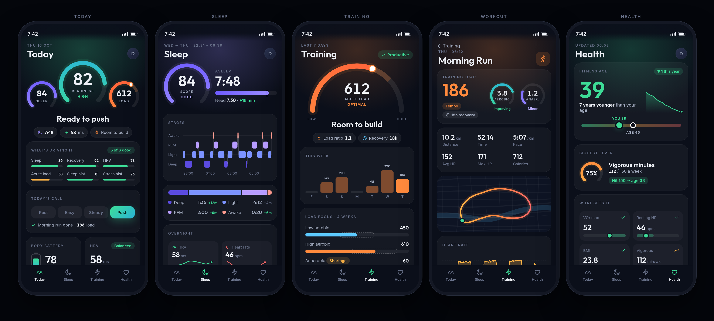

# Pepometer

A Whoop-style app for Garmin watches: open it and see how you're doing, why,
and what to do today, using Garmin's own metrics explained in plain words.

Status: design. See [docs/spec.md](docs/spec.md) and the
[mockup](design/mockup/) (sample data).

Pepometer is not affiliated with Garmin or WHOOP. It uses Garmin Connect's
unofficial API, which Garmin can change at any time.
