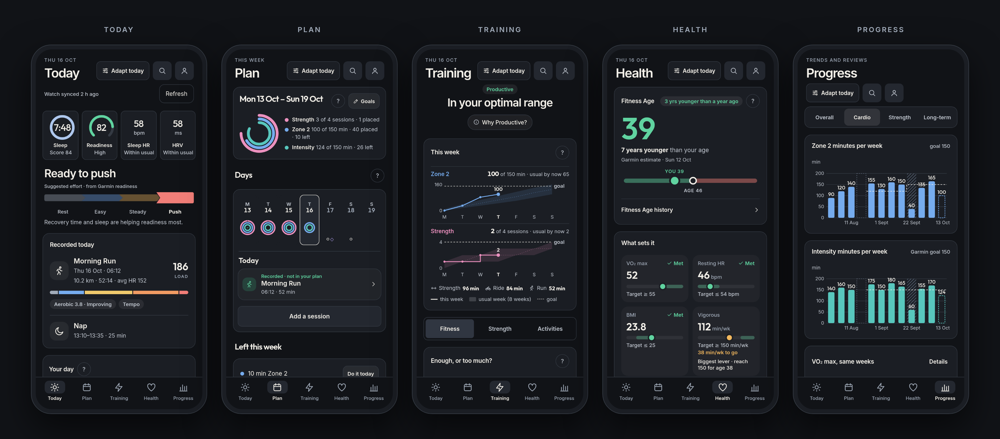

# Raring

[raring.app](https://raring.app)

A readiness, sleep and training app for Garmin watches. Open it to see how
you slept, how ready you are and what today calls for, from Garmin's own
metrics. Set goals for the week, and your workouts count toward them as they
sync.

Free and open source, with no Raring account, subscription, ads or tracking.
Early releases, Android only for now.



## What it shows

- **Today**: last night's sleep, readiness, sleep heart rate and HRV in one
  row, a suggested effort from Garmin's readiness, and the day on one
  timeline.
- **Plan**: weekly goals for strength sessions, Zone 2, Zone 4–5, intensity
  minutes and sleep timing. Sessions you place on days are matched to your
  recordings as they sync; Garmin Coach workouts sit alongside.
- **Sleep**: score and stages against your usual nights, overnight vitals,
  naps and a plan for tonight.
- **Training**: acute load against Garmin's optimal range, load focus, VO₂
  max and race predictions; workout zones, splits and routes; strength sets
  with miscounts flagged, a body map and your best lifts.
- **Health**: Fitness Age and what would lower it, overnight vitals against
  your usual ranges, resting heart rate, stress, Body Battery and weight.
- **Progress**: a weekly review each Monday, goal rings over time, records
  and monthly trends.

Home-screen widgets, an optional status notification, reminders and an export
of your downloaded data come with it. Raring shows Garmin's numbers and
doesn't invent scores; what you see depends on your watch.

## Install

Android 7 or later on an arm64 phone. Install and update with
[Obtainium](https://github.com/ImranR98/Obtainium): add
`https://github.com/dcardamo/raring` as an app. Each GitHub release carries
a signed arm64 APK, and Obtainium updates the app when a new release appears.
You can also download the APK from the
[latest release](https://github.com/dcardamo/raring/releases/latest).

Raring is not affiliated with Garmin. It uses Garmin Connect's
unofficial API, which Garmin can change at any time.

## How it works & privacy

Raring reads your Garmin account, not your watch. Keep Garmin Connect installed
and syncing so your watch data reaches Garmin first.

The Android app talks directly to Garmin and keeps its downloaded data, goals
and plans on your phone. It reads from Garmin and writes only what you ask it
to: today, a weigh-in you add or delete. Nothing is sent to us: no
analytics, telemetry, ads or remote crash reporting. Street maps under workout
routes are downloaded once per area from OpenFreeMap, which sees your IP
address and the area, never your route; Settings turns them off. Sign-in uses
Garmin's page; tokens are encrypted with Android Keystore. **Settings → Sign
out and erase this phone's data** removes local history, plans and your saved
sign-in.
See the [privacy details](https://raring.app/privacy.html) for storage,
notifications, widgets and GitHub hosting caveats.

## Development

A Rust core (`crates/core`: Garmin client, SQLite storage, sync, rules and
view models), a developer CLI (`crates/cli`) and a Tauri 2 app with a Svelte
and TypeScript UI (`app/`). [docs/spec.md](docs/spec.md) describes what
ships, [TODO.md](TODO.md) is the backlog in priority order, and
[AGENTS.md](AGENTS.md) has the full build, emulator and release notes.

Everything runs in the flake's dev shell (x86_64 Linux), which provides Rust,
Node, the JDK and the Android SDK:

```sh
nix develop
cd app && npm ci && npm run dev    # browser preview on synthetic data
```

The CLI runs against a real account; its tokens and data stay in the
gitignored `.data/`:

```sh
cargo run -p raring-cli -- login   # prompts for your Garmin sign-in
cargo run -p raring-cli -- sync
cargo run -p raring-cli -- show today
```

Checks: `cargo test --workspace`,
`cargo clippy --workspace --all-targets -- -D warnings`, and in `app/`
`npm run check && npm test && npm run test:ui && npm run build`.

Never commit Garmin data, tokens or signing keys; the pre-commit hook and CI
scan for them. Test fixtures are synthetic.

## Website

`site/` is the static raring.app site: no JavaScript, build step or third-party
resources. `.github/workflows/pages.yml` checks it in Chromium and deploys only
this directory to GitHub Pages on relevant main pushes. Pull requests only run
the checks. The Android release workflow remains separate (every main push
still publishes an APK).

Local check: `nix develop -c bash -c 'cd app && npm run test:site'`.
Preview: `nix develop -c python3 -m http.server 4174 --bind 0.0.0.0 --directory site`,
then open `http://neptune:4174` from the tailnet.
The app screenshots come from `cd app && npm run screenshots` inside the
dev shell (every screen on synthetic data, in `.data/screens/`). Then
`cd app && node src/scripts/publish-screens.mjs` publishes the site's screens,
the README montage and the social preview. Never replace them with personal
Garmin data.
Fonts and their licenses are copied from `app/src/assets/fonts/`.

The site has no analytics, but GitHub processes ordinary hosting and download
requests; the privacy page distinguishes that from the app's local data.

## License

Licensed under either of the [Apache License, Version 2.0](LICENSE-APACHE)
or the [MIT license](LICENSE-MIT), at your option.

Street maps, including the sample run's map in
`app/src/lib/sample/workoutMap.json`, are drawn from OpenStreetMap data,
© OpenStreetMap contributors, available under the
[Open Database License](https://www.openstreetmap.org/copyright), in the
OpenMapTiles schema (© OpenMapTiles), as served by
[OpenFreeMap](https://openfreemap.org/).

Unless you explicitly state otherwise, any contribution intentionally
submitted for inclusion in Raring by you, as defined in the Apache-2.0
license, shall be dual licensed as above, without any additional terms or
conditions.
